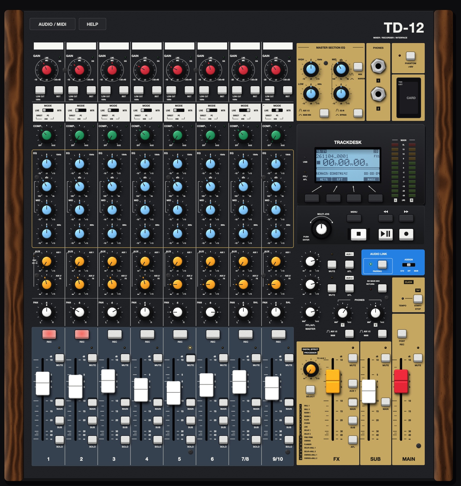

# Trackdesk TD-12

> **This is the `gpui` branch:** Trackdesk with a [GPUI](https://gpui.rs) front end (experimental). [`gpui/README.md`](gpui/README.md) explains how it's built, run and tested. The JUCE app described below still builds from this branch. [`main`](https://github.com/csprech/trackdesk/tree/main) keeps it unchanged.

A desktop 12-track recording console, built for research: an 8-strip mixer with 10 inputs, a 12-track recorder, 16 effects and a master section. Its controls, signal flow, display, menus and recorder behave like the console it studies. That console is the TASCAM Model 12; the [research notes](docs/research.md) cover what it does and where each behaviour comes from.

Trackdesk is original work. It doesn't use TASCAM's names, logos or artwork. "TASCAM" and "Model 12" are trademarks of TEAC Corporation and appear here only to say which console was studied.



## What's on the panel

**Channel strips:** 1–6 are mono; 7/8 and 9/10 are stereo. Each strip has:
- GAIN with the SIG light, LOW CUT (100 Hz) and INST;
- MODE: LIVE (the input jack), PC (the computer) or MTR (the recorder's track);
- COMP: one knob, with its light;
- a 3-band EQ with a swept mid (100 Hz to 8 kHz);
- AUX 1 (pre-fader, or post with the POST light) and AUX 2/FX (post-fader);
- PAN, or BAL on the stereo strips;
- REC, MUTE, the fader, and MAIN, SUB and SOLO.

**Master section:**
- the master EQ (on MAIN or on the AUX outputs, with narrow/wide and EQ IN);
- PHONES 1/2, each switchable to AUX 1/2;
- PHANTOM +48V, which asks for confirmation on the display;
- AUX 1/2 outputs with MUTE and AFL, PFL/AFL MASTER, and SD MAIN MIX RETURN;
- the paired device (AUDIO LINK: PAIRING and ASSIGN 9/10, OFF or MAIN);
- CLICK (TAP/START/STOP and the TEMPO light) and POST REC;
- the effect (SELECT, TO AUX 1, the FX fader, MUTE, AUX 1, MAIN, SUB and AFL);
- the SUB and MAIN faders.

**Display:** a 128 × 64 screen with F1–F4, MENU, the MULTI JOG, the transport keys and the MAIN meter. It has the Meter and Home screens, the whole MENU tree, the EFFECT screen with its library, and the pop-up messages:
- SONG, VAMP, CLICK, MTR, MIDI, MIXER;
- STEREO MIX EXPORT, SD PLAY, STORAGE;
- SYSTEM.

**Recorder:**
- 12 tracks: the 10 inputs, plus the MAIN MIX as tracks 11/12, which always record;
- punch in and out, by hand or automatic with pre-roll and rehearsal;
- repeat, undo and redo, marks, and locating with REW and FF (with STOP + REW/FF to where recording last started or stopped);
- VAMP loops, automatic or manual;
- track clear, swap and import, and the stereo mix export;
- the metronome with count-in, MIDI clock and time code, and the footswitch.

### What stands in for the hardware

- **The SD card** is the folder `Music/Trackdesk Card`. Songs are in `MTR`: each is a folder of mono WAV takes plus `song.json`. Files for IMPORT and SD PLAY go in `MUSIC`. STORAGE opens the folder.
- **Bluetooth:** PAIRING asks for an audio file, which then plays like a phone paired to the console, into 9/10 or the MAIN MIX.
- **The footswitch** is the `\` key.
- **The computer keyboard:** the arrow keys turn the MULTI JOG, Return pushes it, and Space is PLAY.
- **USB, standalone:** the audio device's inputs 1–10 are the input jacks and inputs 11–20 are what PC mode hears. The outputs are MAIN L/R, SUB L/R, AUX 1, AUX 2, PHONES 1 L/R, PHONES 2 L/R and CLICK, then the USB sends 1–12 (USB AUDIO: MULTI INPUT or STEREO MIX). For a computer with only two outputs, AUDIO / MIDI can put PHONES 1 on outputs 1–2.
- **MIDI clock and time code** go to a virtual MIDI port called "Trackdesk", and to the MIDI output you choose.
- **Not reproduced:**
  - DAW control, the MUSIC/TALK jack and the inserts;
  - phantom power and INST have their switches, lights and confirmation, but no audible effect on line signals;
  - DATE/TIME shows the computer's clock.

## Building

You need macOS, CMake 3.22 or later, Ninja and a C++20 compiler.

```sh
scripts/bootstrap.sh                      # JUCE 8.0.15 into external/JUCE
cmake -S . -B build -G Ninja -DCMAKE_BUILD_TYPE=Release
ninja -C build Trackdesk TrackdeskTests
open build/Trackdesk_artefacts/Release/Trackdesk.app
```

## Tests

- `build/TrackdeskTests_artefacts/Release/TrackdeskTests` runs 479 checks. They cover:
  - the panel's laws and the DSP;
  - the mixer's routing, including solo modes, sends, the effect, pads, delay, the click and record taps;
  - the recorder: punch, auto punch, repeat, vamp and edits;
  - the console played through its keys, dial and screens;
  - the card folder: real WAV takes written and memory-mapped.
- The app's self-test works every control through its widget, then records a take and plays it back from the card:

  ```sh
  TRACKDESK_CARD_DIR=/tmp/card TRACKDESK_SETTINGS_DIR=/tmp/settings TRACKDESK_SELFTEST=/tmp/report.txt \
      build/Trackdesk_artefacts/Release/Trackdesk.app/Contents/MacOS/Trackdesk
  ```

  The two folder variables keep your own card and settings out of it.

## In the Tabletop studio

`trackdesk-module.cmake` lists the sources that a host compiles. `src/plugin/TrackdeskProcessor` is the console as an audio processor, with no audio device of its own:
- **12 inputs:** INPUT 1–10 and USB L/R;
- **11 outputs:** MAIN, SUB, AUX 1/2, PHONES 1/2 and CLICK;
- **MIDI out:** clock and time code.

## Layout

- `src/core`: the console without a window, tested headless:
  - `Model`: the state and the panel's laws;
  - `Dsp`: EQ, compressor, effects and click;
  - `Mixer`: the signal flow;
  - `Recorder`: tracks of regions, the transport, punch and vamp;
  - `Desk` and `DeskMenu`: keys, screens and menus;
  - `Lcd`: the display.
- `src/engine`: the audio device, MIDI, settings, and the card folder.
- `src/ui`: the panel on a 1500 × 1580 canvas, laid out from the original's measured drawing, and its widgets.
- `src/plugin`: the processor for hosts.
